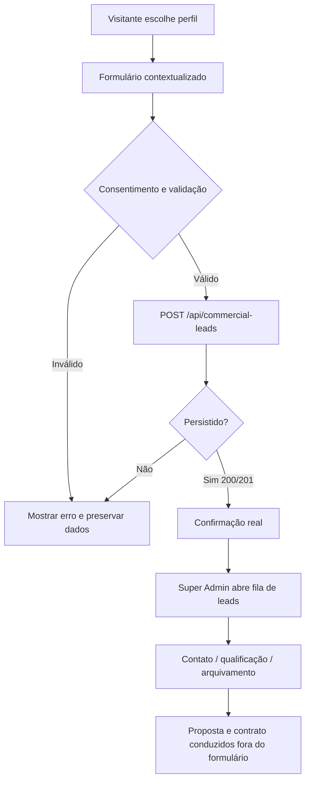

# MVP Comercial — Jornadas, propostas e funil de leads

**Status:** implementação em branch (16/10/2026), pendente build/QA de navegadores e deploy. **Não equivale a checkout, contrato assinado ou campanha publicada.**

## Público e fronteiras contratuais

| Entrada do site | `kind` enviado à API | O que se solicita | O que não acontece automaticamente |
|---|---|---|---|
| Estabelecimentos | `establishment` | Contato para TV/Rádio, quantidade estimada, licenças, locais | Criação de assinaturas, ativação de aparelho e licenciamento |
| Agências | `agency` | Proposta para operação de clientes/locais e permissões | Transferência de carteira, privilégio Master ou faturamento |
| Anunciantes | `advertiser` | Proposta de espaços publicitários TV/Rádio | Reserva de inventário, garantia de audiência ou exibição |

A página principal preserva os links existentes e adiciona a seção `#para-quem` com guias alternáveis por clique, setas, Home e End, etapas do ciclo comercial, advertências e CTA correspondente. Cada CTA envia `kind` e `source` corretos ao formulário existente. O formulário coleta nome, empresa, email, WhatsApp, consentimento LGPD, e detalhes livres; quantidade e segmento de TV são enviados **somente** para `establishment`.

A seção `#planos` passa a pedir um **briefing comercial personalizado**. Sem catálogo aprovado pela API não é adequado prometer preço fixo, plano Bronze/Ouro, 20% de desconto, equipamentos inclusos, taxa zero ou retorno de investimento. Foram removidas simulações tarifárias e testemunhos com pessoas/empresas e ganhos que não tinham fonte de comprovação. No futuro, valores públicos devem ser derivados de catálogo versionado e juridicamente aceito.

## Do clique à central comercial

O backend já possui `SiteCommercialLeadController::store` com UUID idempotente, consentimento, validação de telefone/email, `website` honeypot, throttle e origem/UTM. `received:true` em HTTP 200/201 é a **única confirmação** de lead registrado. Respostas de erro 409/422/429/5xx e perda de rede não devem marcar sucesso nem limpar o formulário; retry reutiliza o mesmo UUID. Nenhum email ou telefone fica na URL.

O endpoint privado `GET /api/v1/site/commercial-leads` continua exclusivo do `Super-Admin` via `auth:api`. Sua resposta ganhou `summary.total`, `summary.statuses.{new,contacted,qualified,archived}` e `summary.kinds.{establishment,agency,advertiser}` **calculados no MySQL sem truncar pela página ou pelos filtros**. O Admin Metronic mostra o funil, filtra, pagina, permite ler detalhes e atualizar `status` por `PATCH`. Nenhuma compra de anúncios nem recebível é gerado por status.

## Homologação e riscos

1. Com três CTAs de `#para-quem`, abrir o formulário e verificar a opção correta. Para anunciante, os campos de `telas/segmento` não devem ser enviados; pedir localização, público, mídia TV/Rádio e período nos detalhes. Para agência, pedir tamanho da carteira.
2. Preencher duas vezes o formulário com o **mesmo** UUID e mesmo conteúdo; a API deve retornar 201 na primeira inserção e 200 no retry, sem duplicar lead. Com UUID igual e conteúdo diferente, 409.
3. Recusar consentimento e preencher honeypot: API retorna 422 e nenhum lead. Verificar 429 com throttle sem exibir sucesso.
4. Validar `utm_source`, `utm_medium`, `utm_campaign` como origem, sem enviar dados pessoais para analytics. Consultar a fila privada e filtrar `kind`, `status` e página.
5. Criar 100+ leads em MySQL descartável; verificar que a soma por público e estágio inclui toda a base, enquanto `pagination.total` é filtrado e `summary.total` é global.
6. Testar negado para operador comum, anônimo e token de cliente; somente Super Admin enxerga dados pessoais. Verificar troca de filtros sem manter cartões de outra pesquisa visíveis.
7. Executar `npm run test:radio`, `npm run test:journeys`, `npm run lint`, `npm run build` no site; `npm run check:commercial-funnel` e `npm run build` no Admin; PHPUnit e Swagger na API; QA 320–1440px, teclado, contraste e navegador real.
8. Testar `/api/commercial-leads` no domínio implantado com proxy TLS e política de erros. Sem infraestrutura/CI executada, **não afirmar deploy ou MVP homologado**.

**Próximos itens para MVP:** revisão de campanha/inventário com contratos e pagamentos separados, portal de assinante, Player de Rádio/TV homologado no aparelho e CI MySQL/Node/Composer operacional.
